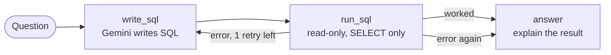

# SQL Agent

[](https://github.com/jwalini-divya/sql-agent/actions/workflows/ci.yml)

Ask questions about a database in plain English. The agent writes the SQL, runs it safely, **fixes its own SQL if it fails**,
and answers in a simple sentence.

**Stack:** LangGraph · LangChain · FastAPI · Python · SQLite · Google Gemini (free API key)

Example (the exact wording of the answer can vary):

```
Question:  Which customer spent the most money?
SQL:       SELECT c.name, SUM(p.price * o.quantity) AS total FROM orders o
           JOIN customers c ON c.id = o.customer_id JOIN products p ON p.id = o.product_id
           GROUP BY c.name ORDER BY total DESC LIMIT 1
Rows:      [{"name": "Asha", "total": 60000.0}]
Answer:    Asha spent the most money, a total of 60,000.
```

## How it works



- **LangGraph** runs the steps. The loop from `run_sql` back to `write_sql` lets the agent see its error and correct the SQL (max 2 tries).
- **Safety:** only `SELECT` queries are accepted, the database connection is **read-only**, and only one statement runs at a time.
- **Sample data:** a small shop database (`customers`, `products`, `orders`) is created automatically on first start.

## Run it (Windows)

1. Get a free API key at https://aistudio.google.com/apikey (sign in with Google).
2. In this folder:
   ```bash
   python -m venv .venv
   .venv\Scripts\activate
   pip install -r requirements.txt
   copy .env.example .env        # then paste your key into .env
   uvicorn app:app --reload
   ```
3. Open http://localhost:8000 → `POST /ask` → **Try it out**, and ask:
   - *Which customers live in Hyderabad?* → Asha and Kiran
   - *Which customer spent the most money?* → Asha, 60,000
   - *How many orders were placed in September 2026?* → 4
   - *Delete all orders* → nothing is deleted: only read-only queries can run

## Tests

```bash
pytest -q
```

The tests use a fake LLM, so they need no API key. They check the normal answer, the self-correction loop,
giving up after 2 tries, that write queries are blocked, and the API response. GitHub Actions runs them on every push.

## Files

```
app.py     FastAPI: POST /ask
agent.py   LangGraph agent: write_sql → run_sql → answer (with the retry loop)
db.py      sample SQLite database and the safe run_query function
tests/     pytest tests with a fake LLM
```
